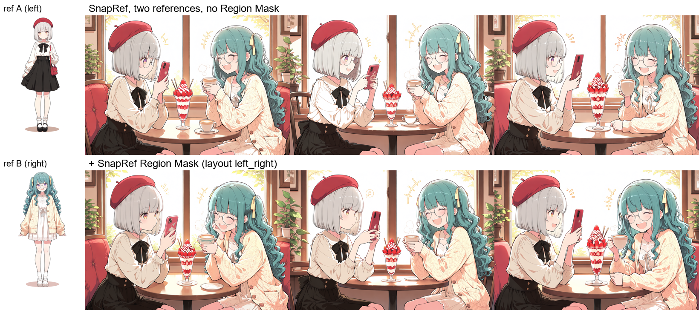
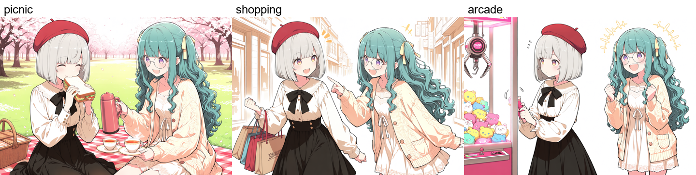
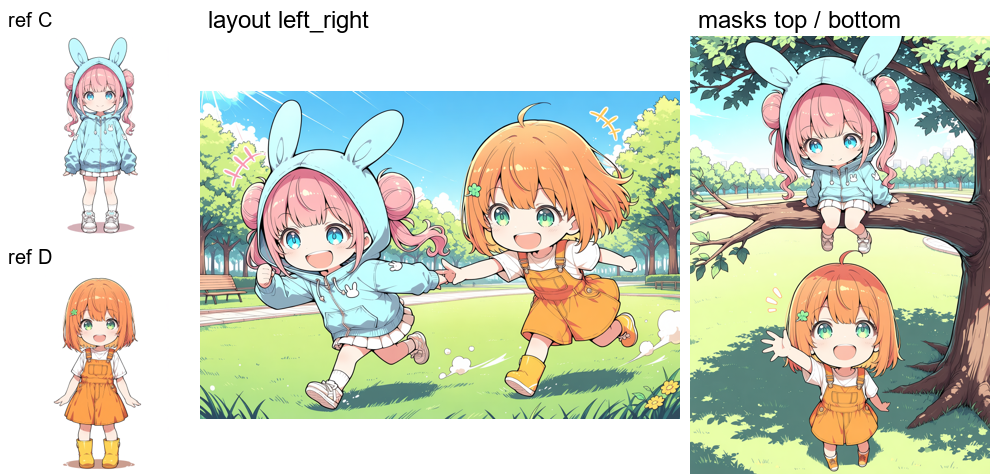
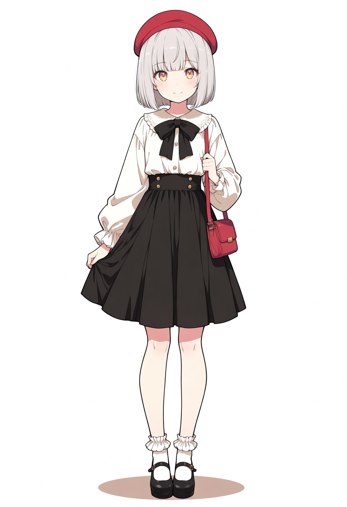
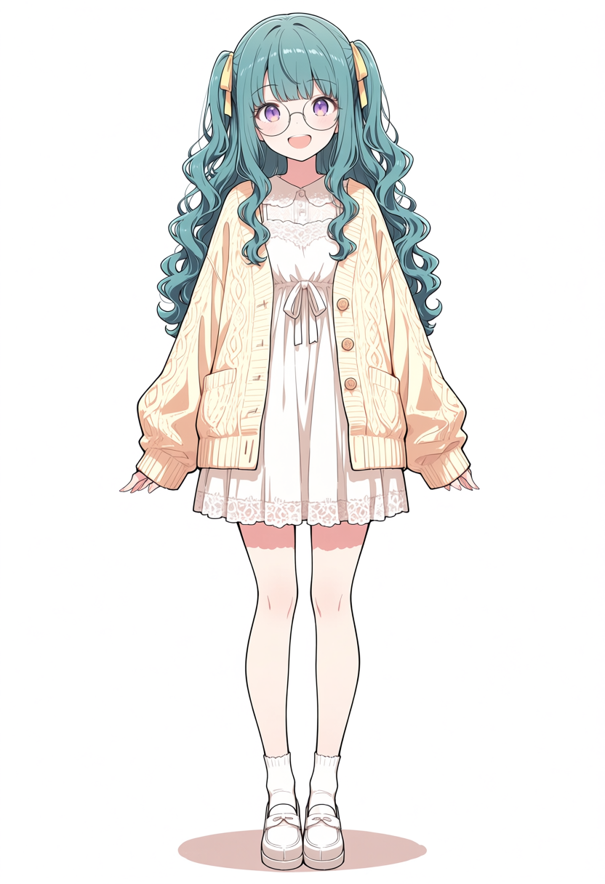
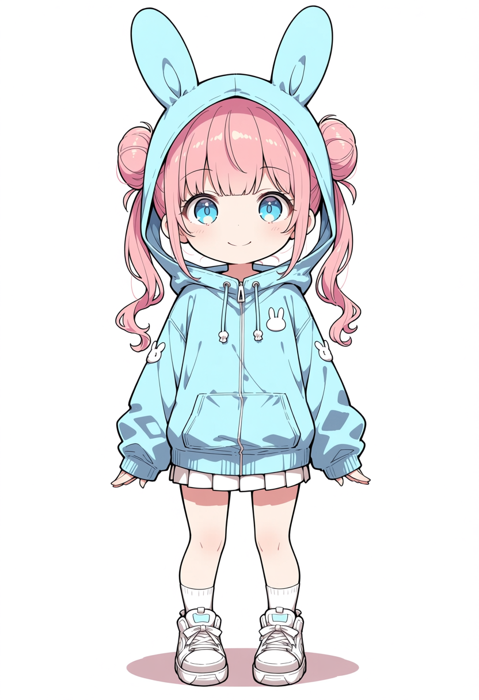
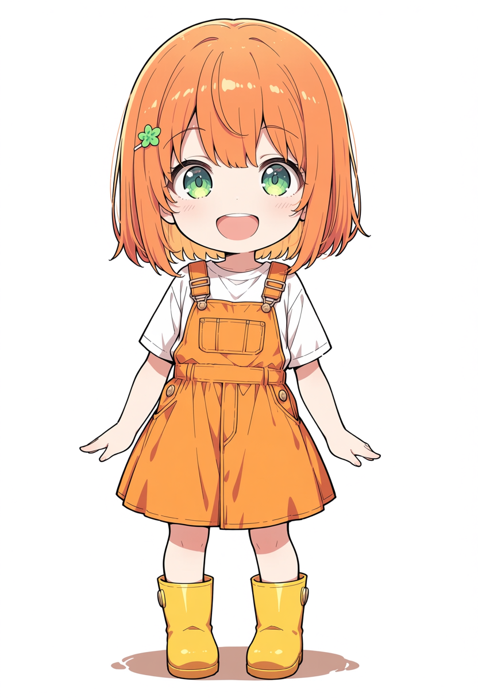

# ComfyUI-SnapRef-RegionMask

[English](README.md) | 日本語

Animaの[SnapRef](https://github.com/ArcAnima/SnapRef)に、参照画像ごとの領域を指定するノードです。2人の髪・服・小物の混入を抑えます。左右・上下の分割、長方形、任意のMASKが使えます。







## 導入・使い方

Anima対応のComfyUI、SnapRefノードとアダプター、Animaのモデル・テキストエンコーダー・VAE、fp16/bf16対応のCUDA GPUが必要です。

```sh
cd ComfyUI/custom_nodes
git clone https://github.com/nirvash/ComfyUI-SnapRef-RegionMask
```

ComfyUIを再起動し、SnapRefのMODEL出力とKSamplerの間に **SnapRef → SnapRef Region Mask** を接続します。SnapRefは `multi_layout = separate`、キャラごとに参照1枚を指定してください。領域プロンプト用ノードは不要です。

## サンプル

[生成画像とプロンプトの内容一覧](examples/README.md)

`examples/input` の画像を `ComfyUI/input` にコピーし、JSONをComfyUIで開きます。モデル・CLIP・VAE・アダプターのファイル名を手元のものに変更して実行してください。

| ワークフロー（examples内） | 内容 | 出力 |
|---|---|---|
| `snapref_region_mask_sample_boxes.json` | Aを左、Bを右に配置 | `sample_boxes_output.png` |
| `snapref_region_mask_sample_masks.json` | MASKでCを上、Dを下に配置 | `sample_masks_output.png` |
| `snapref_region_mask_sample_arcade.json` | 参照を左右交換：Bが左で△口、Aが右側の筐体を操作。boxで筐体を参照領域から除外 | `sample_arcade_output.png` |

`*_api.json` はAPI形式です。出力PNGにもワークフローを埋め込んでいます。Region Maskノードをバイパス（Ctrl+B）すると、同条件でノードなしの結果を比較できます。

| A | B | C | D |
|---|---|---|---|
|  |  |  |  |

## 入力

数値範囲はノードのUI設定値です。座標・寸法は画像全体を1とする割合です。

| 入力 | 範囲・選択肢 | 既定値 | 説明 |
|---|---|---|---|
| `model` | MODEL | — | SnapRefのMODEL出力 |
| `layout` | `left_right` / `top_bottom` / `boxes` | `left_right` | 左右分割・上下分割・長方形指定。参照1は左／上、参照2は右／下 |
| `split` | 0.05–0.95 | 0.5 | 左右／上下分割の境界 |
| `feather` | 0–0.5 | 0.05 | 長方形の境界をぼかす幅。MASKは元の濃淡を使用 |
| `outside_strength` | 0–1 | 0 | 領域外で参照を残す強さ。0は無効、1は領域外も同じ強さ |
| `ref_start` | 0–0.95 | 0.1 | 最初に参照を使わないステップの割合 |
| `x`, `y` | 各0–1 | 0, 0 | `boxes`の参照1の左上座標 |
| `width`, `height` | 各0–1 | 0.5, 1 | 参照1の幅・高さ |
| `x_2`, `y_2` | 各0–1 | 0.5, 0 | 参照2の左上座標 |
| `width_2`, `height_2` | 各0–1 | 0, 1 | 参照2の幅・高さ。`width_2 = 0`は全参照に領域1を使用 |
| `mask_1`, `mask_2` | MASK、値0–1 | 未接続 | 白い部分で参照を見る。その参照のレイアウト指定より優先 |

MASKはモデルのトークン格子に合わせてリサイズされます。3枚目の参照（`image_3`）は領域2を使用します。

人物が画面の一部に寄る場面では、`boxes`で人物の範囲だけを指定し、筐体などを参照領域から外せます。

## 使用上の注意

- 人物の位置と髪・目・服をプロンプトで簡潔に補足してください。SnapRefの `strength` は既定値の0で検証しています。
- マスクが有効なのは `fidelity = 1`、`ref_guidance_on = off`、`ref_in_uncond = off`、CUDAのfp16/bf16です。それ以外ではマスクなしのSnapRefとして動作します。
- 参照の完全な再現は保証しません。人物が境界をまたぐ構図、大きく重なる構図では混入や崩れが起こり得ます。領域内の小物にも参照が乗る場合があります。
- 検証：SnapRef v2a pre2、hakushiMixAnima v1.0、30 steps、er_sde / simple、CFG 4、1216×832／832×1216。

[仕組み・検証メモ・Anima Regionalとの併用](docs/notes.ja.md)

## テスト・ライセンス

`python -m pytest tests`（ComfyUIなしで実行可能）。Apache-2.0：[LICENSE](LICENSE)、[NOTICE](NOTICE)。SnapRefとアダプターのライセンスはそれぞれの配布元を確認してください。
