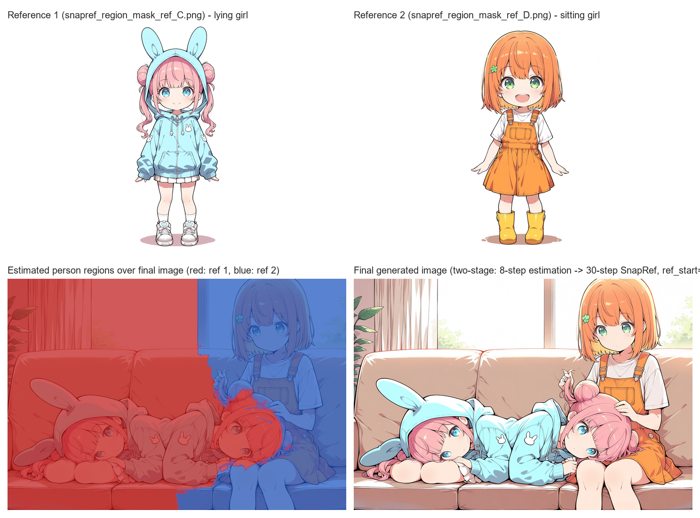

# ComfyUI-SnapRef-RegionMask

English | [日本語](README.ja.md)

Assign a region to each [SnapRef](https://github.com/ArcAnima/SnapRef) reference image in Anima to reduce mixing of hair, clothing and accessories between two characters. Supports left/right splits, top/bottom splits, boxes and arbitrary MASKs. The regions can also be estimated from the generation itself, without drawing them ([Automatic masks](#automatic-masks-experimental), experimental).




## Install and use

Requires ComfyUI with Anima support, the SnapRef node and adapter, an Anima model with matching text encoder and VAE, and a CUDA GPU supporting fp16/bf16. The automatic masks' min-cut segmentation needs `pip install pymaxflow` (Auto Mask raises a clear error without it).

```sh
cd ComfyUI/custom_nodes
git clone https://github.com/nirvash/ComfyUI-SnapRef-RegionMask
```

Restart ComfyUI. Connect **SnapRef → SnapRef Region Mask** between SnapRef's MODEL output and KSampler. Set SnapRef to `multi_layout = separate` with one reference image per character. No regional prompting node is required.

## Samples

[Example images and prompt descriptions (Japanese)](examples/README.md)

Copy images from `examples/input` to `ComfyUI/input`, open a workflow JSON in ComfyUI, and select your model, CLIP, VAE and adapter files.

| Workflow (in examples) | Scene | Output |
|---|---|---|
| `snapref_region_mask_sample_boxes.json` | A on the left, B on the right | `sample_boxes_output.png` |
| `snapref_region_mask_sample_masks.json` | C above, D below, using MASKs | `sample_masks_output.png` |
| `snapref_region_mask_sample_arcade.json` | Swapped references: B left with a triangle mouth, A operating on the right; boxes exclude the machine from reference regions | `sample_arcade_output.png` |
| `snapref_region_mask_sample_auto.json` | Picnic: C left, D right, automatic masks instead of drawn regions (person terms `girl on the left` / `girl on the right`) | `sample_auto_output.png` (regions: `sample_auto_regions.png`) |

`*_api.json` files are API graphs. Output PNGs also contain their editing workflows. Bypass Region Mask (Ctrl+B) to compare against SnapRef alone with the same settings.

| A | B | C | D |
|---|---|---|---|
|  |  |  |  |

## Inputs

Ranges below are the node's UI ranges. Coordinates and dimensions are fractions of the full image.

| Input | Range / choices | Default | Description |
|---|---|---|---|
| `model` | MODEL | — | SnapRef's MODEL output |
| `layout` | `left_right` / `top_bottom` / `boxes` | `left_right` | Split horizontally, vertically, or use boxes. Reference 1 goes left/top; reference 2 right/bottom |
| `split` | 0.05–0.95 | 0.5 | Boundary of the left/right or top/bottom split |
| `feather` | 0–0.5 | 0.05 | Soft edge width for boxes. MASKs retain their own soft edges |
| `outside_strength` | 0–1 | 0 | Reference strength outside its region: 0 disables it, 1 keeps full strength |
| `ref_start` | 0–0.95 | 0.1 | Initial fraction of sampling steps without references |
| `x`, `y` | 0–1 each | 0, 0 | Top-left of reference 1's box |
| `width`, `height` | 0–1 each | 0.5, 1 | Width and height of reference 1's box |
| `x_2`, `y_2` | 0–1 each | 0.5, 0 | Top-left of reference 2's box |
| `width_2`, `height_2` | 0–1 each | 0, 1 | Reference 2's width and height. `width_2 = 0` uses region 1 for all references |
| `mask_1`, `mask_2` | MASK, values 0–1 | disconnected | White reads the reference. Overrides that reference's layout region |

MASKs are resized to the model's token grid. A third reference (`image_3`) uses region 2.

When characters occupy only part of the canvas, use `boxes` to limit references to their regions and leave objects such as the machine outside them.

## Automatic masks (experimental)

Instead of drawing regions, estimate each person's region from the generation itself, for prompts that do not fix the composition.

| Node | Role |
|---|---|
| SnapRef Region Probe | MODEL → MODEL, REGION_PROBE. Records how image tokens attend to two person terms of the prompt (`person_1` for SnapRef `image`, `person_2` for `image_2`; variants separated by `\|`). Set `auto_mask` to the weights name. With `instance_mask` (on by default) it also records which image tokens attend to each other in block 16 (one step), so a person is kept together. With `ref_affinity` on (after SnapRef Region Mask) it records which reference each image token resembles. Put it last in the model chain |
| SnapRef Region Auto Mask | IMAGE + REGION_PROBE → `mask_1`, `mask_2` for SnapRef Region Mask. Groups the image tokens into instances by the recorded self-attention, gives each instance the person whose term it attends to, and snaps the outline to image edges (SLIC; then a binary min-cut over the superpixel graph by default, `segmentation_method = graph_cut`, `lambda_smooth = 0.25`, needs the `pymaxflow` package - a weak own score follows the neighbouring side across image boundaries; on our 29-image test set that cut the worst scene's swap error from 11.7% to 10.0% with no scene over 10%, for about 5 ms). `segmentation_method = existing` keeps the plain majority vote. `source`: `attention` (person terms), `reference` (resemblance to each reference) or `both` (person terms, plus parts such as hats that resemble one reference; `ref_weight` 1) |
| SnapRef Region Auto Mask Panel | Draws the regions over the estimation image and the final image, for checking |

Recommended graph (same seed, sampler, scheduler and CFG in both stages, 30 steps):

1. **Estimate**: model → Region Probe (`auto_mask`, `instance_mask` on) → KSamplerAdvanced steps 0–8 (`return_with_leftover_noise = disable`) → VAEDecode → Auto Mask → masks.
2. **Final**: SnapRef → Region Mask (the masks, `ref_start = 0.0`) → KSampler, 30 steps.

The masks come from step 8 without the references, so the prompt has to fix who is where. Use person terms that fit the composition, and refer to the people with the same words in the prompt, with their looks bound to them:

- side by side: `girl on the left` / `girl on the right` ("the girl on the left has … and wears …")
- a lap pillow: `lying girl` / `sitting girl` ("the sitting girl sits on the couch, the lying girl rests her head on the sitting girl's lap, the sitting girl has …"); left / right does not fit, the lying girl's head is on the other side
- a girl and a man: `1girl | girl` / `1man | man`

On three lap-pillow images (references used for the final pass, masks traced by hand) 3.8% of the person pixels went to the other person; one image takes about 16 s at 1216×832. Describing the looks in detail pulls the result toward the prompt rather than the references, so keep it to the features the references show.

When SnapRef moves the composition a lot, a third stage helps: a 4-step draft, then SnapRef with the draft masks for steps 0–8 of the schedule and the masks estimated again from that pass (`source = both`, Region Mask `ref_start = 0.3125` inside the 8-step segment). The sample workflow `examples/snapref_region_mask_sample_auto.json` uses this variant. On the lap pillow it was worse (9.6%) and 4 s slower. Region Probe's `text` must be exactly the positive prompt: when you edit the prompt, paste it into the probes too.

Limits:

- The bundled weights `hakushi_anima_gt_v1` were fitted on hakushiMixAnima v1.0 with the person terms `1girl | girl` and `1man | man` (29 hand-checked images). With other terms (positions, roles) Auto Mask uses the plain mean of the blocks instead, which did better there. Hair or clothing words as person terms do not work: person 1 gets only the named items.
- Two people only. The masks only limit where each reference is read; words in the prompt and self-attention between image tokens still reach both people.

[How the automatic masks work and how to fit your own weights](docs/auto_mask.en.md)

## Notes

- Briefly describe each character's position, hair, eyes and clothing in the prompt. Examples were tested with SnapRef `strength = 0` (the default).
- Masking requires `fidelity = 1`, `ref_guidance_on = off`, `ref_in_uncond = off`, and CUDA fp16/bf16. Other settings run SnapRef without masking.
- Exact reference fidelity is not guaranteed. Characters crossing region boundaries or overlapping heavily can mix or break. Objects inside a region can also pick up reference features.
- Tested: SnapRef v2a pre2, hakushiMixAnima v1.0, 30 steps, er_sde / simple, CFG 4, 1216×832 / 832×1216.

[Implementation, experiment notes and Anima Regional integration](docs/notes.en.md)

## Tests and license

`python -m pytest tests` (runs without ComfyUI). Apache-2.0: [LICENSE](LICENSE), [NOTICE](NOTICE). SnapRef and its adapter weights have separate licenses.
