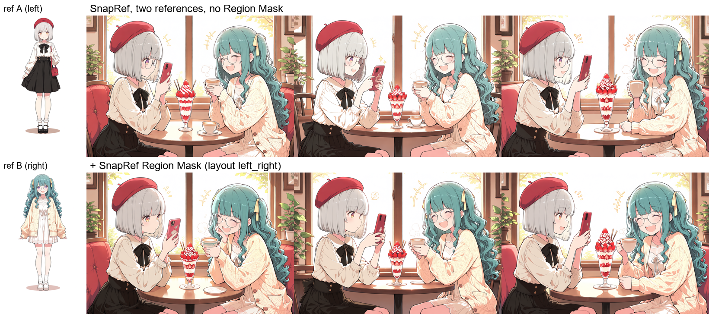
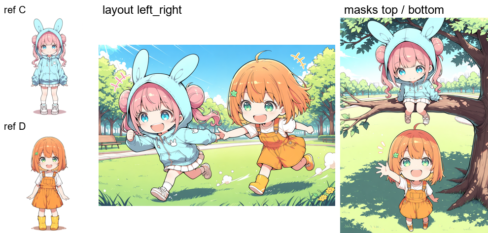
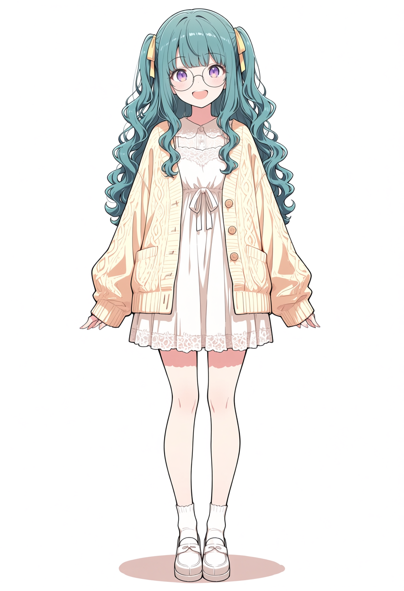
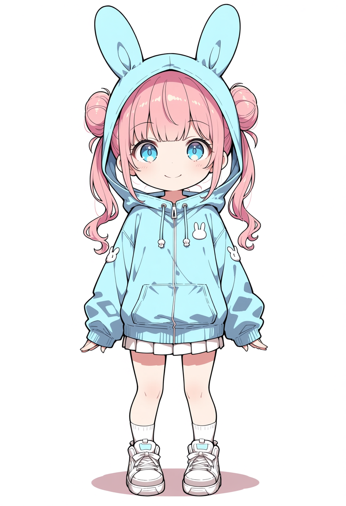

# ComfyUI-SnapRef-RegionMask

English | [日本語](README.ja.md)

**One reference image per character, each read only where that character stands.**

[SnapRef](https://github.com/ArcAnima/SnapRef) lets Anima draw a character from a single reference image.
With two different characters (`image` + `image_2`), however, both references leak into both people:
hair, glasses, eye colour or clothes of one character turn up on the other.

This node gives every SnapRef reference its own region. Reference 1 is read only in region 1,
reference 2 only in region 2. A region is a left / right or top / bottom split, a box, or any MASK.



*Same seeds and prompt. Top: SnapRef with two references — the left girl gets the right girl's glasses
and purple eyes. Bottom: + SnapRef Region Mask (`layout = left_right`).*




## How it works

SnapRef prepends the key/value tokens of the reference image to every self-attention call of Anima.
This node adds a per-token bias to the attention scores of each reference:

- inside the reference's region: `0` (read exactly as SnapRef reads it)
- outside: `log(outside_strength)`, i.e. `-inf` by default (not read at all)
- a short ramp (`feather`) softens box edges; a MASK keeps its own soft edges

Inside a region the computation is identical to plain SnapRef. The node does not touch the text prompt
(cross-attention), SnapRef's weights or ComfyUI. Its attention hook is attached for each model call and
removed right after, so the model is left as SnapRef set it up.

For the first `ref_start` fraction of the steps no token reads any reference, so the prompt places the
people first.

## Requirements

- ComfyUI with Anima support
- [SnapRef](https://github.com/ArcAnima/SnapRef) node and adapter (`snapref_v2a_pre2.safetensors` was used here)
- An Anima-based diffusion model, `qwen_3_06b_base` text encoder and `qwen_image_vae`
- CUDA GPU with fp16/bf16 (the masked attention uses the fused SDPA kernels with log-sum-exp)

## Install

```
cd ComfyUI/custom_nodes
git clone https://github.com/nirvash/ComfyUI-SnapRef-RegionMask
```

Restart ComfyUI. The node appears as **SnapRef → SnapRef Region Mask**.

## Sample workflows

Copy the images in `examples/input` into `ComfyUI/input`, drag a workflow into ComfyUI, change the
UNET / CLIP / VAE / SnapRef adapter file names to yours, and queue. Each `*_output.png` is the result of
its workflow and carries the workflow in its metadata, so it can be dragged into ComfyUI as well.

| Workflow | Regions | References | Output |
|---|---|---|---|
| `snapref_region_mask_sample_boxes.json` | `layout = left_right`, `split = 0.5` | A (left), B (right) | `sample_boxes_output.png` |
| `snapref_region_mask_sample_masks.json` | `mask_1` = top half, `mask_2` = bottom half (Load Image (as Mask)) | C (top), D (bottom) | `sample_masks_output.png` |

The `*_api.json` files are the same graphs in API format.
Bypass the **SnapRef Region Mask** node (Ctrl+B) to see the references mix without it.

| A | B | C | D |
|---|---|---|---|
|  |  |  |  |

## Wiring

```
UNETLoader ─┐
CLIPLoader ─┼─ SnapRef (image = A, image_2 = B, multi_layout = separate)
VAELoader  ─┘        │
                SnapRef Region Mask (layout / split, or mask_1 / mask_2)
                     │
                  KSampler ── CLIPTextEncode ("..., the girl on the left ..., the girl on the right ...")
```

Put the node directly after SnapRef. No regional prompting node is needed.

## Inputs

| Input | Default | Meaning |
|---|---|---|
| `model` | | MODEL output of SnapRef |
| `layout` | `left_right` | `left_right`: reference 1 (`image`) left of `split`, reference 2 (`image_2`) right. `top_bottom`: reference 1 above, reference 2 below. `boxes`: use the box inputs below |
| `split` | 0.5 | Where the two regions meet, as a fraction of the width (`left_right`) or height (`top_bottom`) |
| `feather` | 0.05 | Soft edge width of box regions (fraction of the image). Edges on the image border are not softened |
| `outside_strength` | 0 | How much a reference is still read outside its region (0 = not at all) |
| `ref_start` | 0.1 | Fraction of the steps with no reference at all (layout first). With 30 steps, 0.1 = steps 1-3 |
| `x`, `y`, `width`, `height` | 0, 0, 0.5, 1 | `layout = boxes`: box of reference 1, fractions of the image |
| `x_2`, `y_2`, `width_2`, `height_2` | 0.5, 0, 0, 1 | `layout = boxes`: box of reference 2. `width_2 = 0`: every reference uses box 1 |
| `mask_1`, `mask_2` | | MASK of reference 1 / 2 (white = reads the reference). A connected mask overrides `layout` for that reference |

Masks of any size are resized to the model's token grid. Paint one in the mask editor
(right-click a Load Image node → *Open in MaskEditor*) or build it with *Solid Mask* / *Mask Composite*.
A third reference (`image_3`) uses region 2.

## Tips

- **Keep SnapRef `strength` at its default (0).** All results here use it.
- **Describe each character briefly in the prompt.** The references alone separate the two people, but
  writing hair, eyes and clothes per side ("the girl on the left has ... and wears ...") raises fidelity:
  in our cafe test, one girl's outfit changed colour in 3 of 4 seeds without the description and in none
  of 8 with it. This also happens with plain SnapRef and one reference, so it is not caused by the node.
- **Say who is where.** The regions must match the layout of the prompt. A character drawn across a region
  edge loses its reference outside its region (a face on the edge can break).
- **`ref_start`.** We found no clear difference between `0` and `0.1` in reference fidelity. The only
  difference: with `0`, one character was duplicated in 2 of 4 seeds in a scene of two people standing
  close side by side (twice, at two settings); with `0.1` this never happened. `0.1` is the default.
- References can leak onto objects inside a region (e.g. plush toys with the character's face).
- Characters that overlap a lot (hugging, one in front of the other) are not handled.

## Using it with Anima Regional (optional)

It also works with [ComfyUI-Anima-Regional](https://github.com/An1X3R/ComfyUI-Anima-Regional), which can pin
each character's action to a region. Things to know:

- Use exactly the same regions in the Regional layout and in this node. Overlapping regions caused broken faces.
- Apply Regional once per graph.
- **Stale prompt (Anima Regional 0.4.7):** when the model stays loaded and the Regional prompt changes, Regional
  wraps its previous patch and keeps the previous text. Unload the models (*Unload Models* or `POST /free`)
  after changing the prompt. This happens without SnapRef too.
- SnapRef runs a cond/uncond batch as two calls with the original `cond_or_uncond` markers, which made Regional
  route the negative half as well (`unusable cond_or_uncond markers [1, 0] for batch 1`). This node rewrites the
  markers for those calls. The warning still appears once per run while SnapRef encodes the references
  (Regional routes that pass too); that comes from SnapRef and Regional and cannot be fixed here.

## Limitations

- Masking runs only on SnapRef's default path: `fidelity = 1`, `ref_guidance_on = off`, `ref_in_uncond = off`,
  CUDA fp16/bf16. Elsewhere SnapRef runs unchanged (no mask).
- Tested with SnapRef v2a pre2 and hakushiMixAnima v1.0 (Anima), 30 steps, er_sde / simple, CFG 4,
  1216×832 and 832×1216.
- It relies on SnapRef internals (`_ref_kv_state` on each block's `self_attn`). A future SnapRef version may need an update.

## Tests

```
python -m pytest tests
```

The tests cover masks, layouts, the schedule, the marker fix and the hook restore, and run without ComfyUI.

## License

Apache License 2.0. See [LICENSE](LICENSE) and [NOTICE](NOTICE).
SnapRef is a separate project under Apache-2.0; its adapter weights have their own license.
