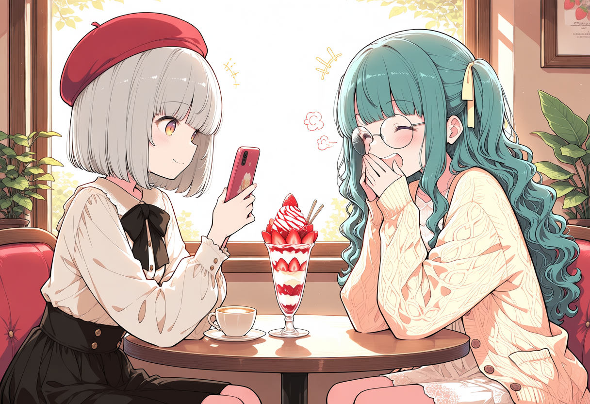
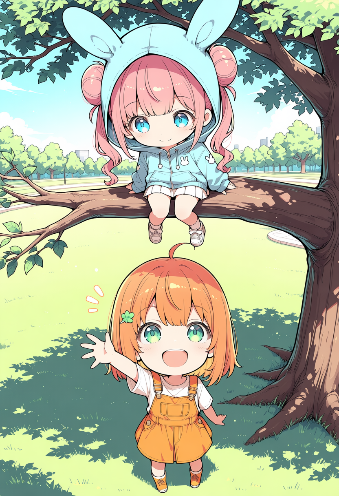
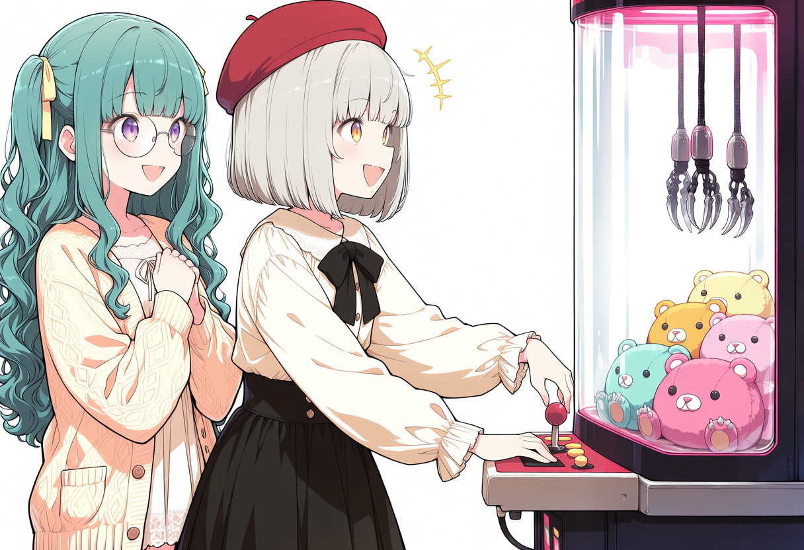
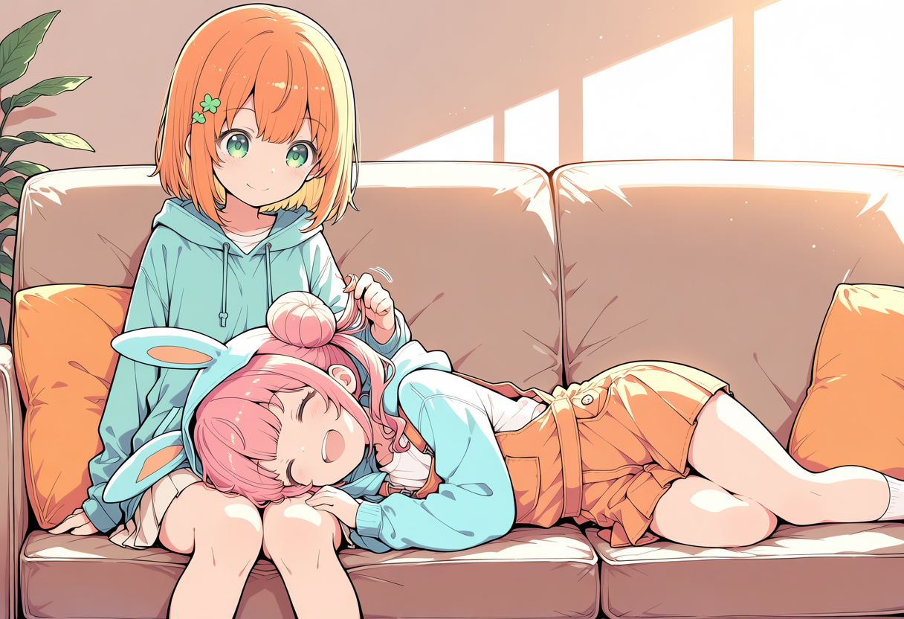
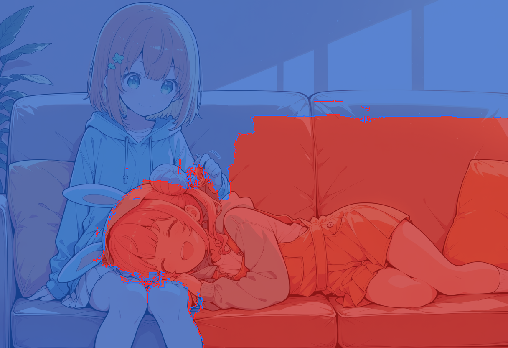
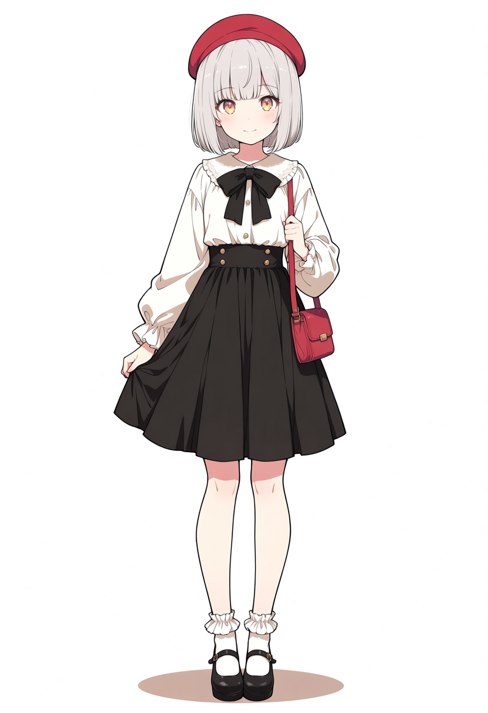
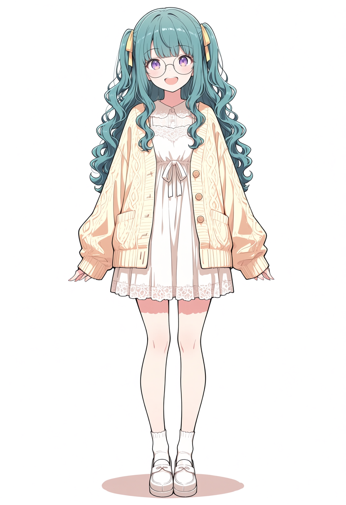
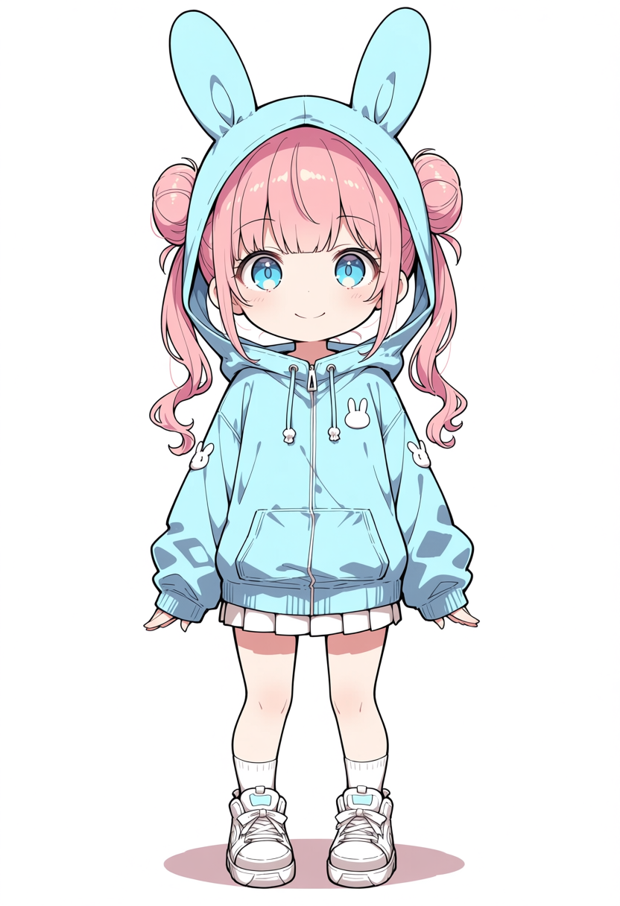
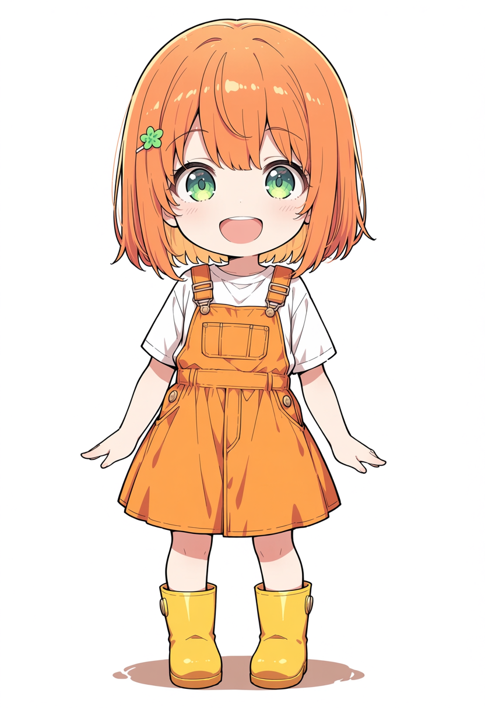

# 生成例

[日本語README](../README.ja.md) · [English README](../README.md)

`input/` の画像をComfyUIの `input/` へコピーし、各ワークフローのモデル・CLIP・VAE・SnapRefアダプターを手元のファイルに変更してください。生成画像にもワークフローを埋め込んでいるので、画像をComfyUIへドラッグして開けます。

| 例 | 参照と配置 | 領域の指定 | ワークフロー |
|---|---|---|---|
| [カフェ](#カフェ左右分割) | A＝左、B＝右 | 左右分割 | [UI](snapref_region_mask_sample_boxes.json) / [API](snapref_region_mask_sample_boxes_api.json) |
| [木の上と下](#木の上と下上下mask) | C＝上、D＝下 | 上下のMASK | [UI](snapref_region_mask_sample_masks.json) / [API](snapref_region_mask_sample_masks_api.json) |
| [クレーンゲーム](#クレーンゲーム左右交換box) | B＝左、A＝右 | 人物ごとのbox | [UI](snapref_region_mask_sample_arcade.json) / [API](snapref_region_mask_sample_arcade_api.json) |
| [膝枕（交差構図・自動マスク）](#膝枕交差構図自動マスク) | C＝寝ている側、D＝座っている側 | 自動マスク（2段推定） | [UI](snapref_region_mask_sample_auto.json) / [API](snapref_region_mask_sample_auto_api.json) |

## カフェ：左右分割

**プロンプトの内容：** 午後の日差しが入るカフェで、窓際の丸テーブルを挟んだ2人。左のAは穏やかに笑いながら苺パフェをスマホで撮影し、右のBは口元に手を添えて笑います。背景にラテと観葉植物を指定しています。

容姿の補足は、Aに銀色ボブ・赤ベレー・白ブラウス・黒リボン・黒スカート、Bに長い青緑のウェーブ髪・黄色リボン・丸眼鏡・淡黄色カーディガン・白レースのワンピースです。

`layout = left_right`、`split = 0.5`。参照1のAを左半分、参照2のBを右半分へ割り当てます。ファイル名の `boxes` はサンプル名で、この例の設定は左右分割です。

[生成画像](sample_boxes_output.png) · [ワークフロー](snapref_region_mask_sample_boxes.json) · [正確なプロンプト・設定（API JSON）](snapref_region_mask_sample_boxes_api.json)

## 木の上と下：上下MASK

**プロンプトの内容：** 晴れた公園の大きな木と、ちびキャラ2人。上のCは涙目で緊張しながら枝にしがみつき、下のDは心配そうに見上げて受け止めようと両手を上げます。

容姿の補足は、Cにピンクのお団子髪・青い目・うさ耳フード付き水色パーカー・白プリーツスカート、Dに短いオレンジ髪・緑の髪留めと目・白Tシャツ・オレンジのオーバーオールワンピースです。

`mask_1` に [上半分のMASK](input/snapref_region_mask_mask_top.png)、`mask_2` に [下半分のMASK](input/snapref_region_mask_mask_bottom.png)を接続し、白い範囲へ各参照を割り当てます。画像ではCが枝の上に乗る姿になっており、指示した動作の厳密な再現を保証する例ではありません。

[生成画像](sample_masks_output.png) · [ワークフロー](snapref_region_mask_sample_masks.json) · [正確なプロンプト・設定（API JSON）](snapref_region_mask_sample_masks_api.json)

## クレーンゲーム：左右交換・box

**プロンプトの内容：** カフェの例から参照の順番を交換し、Bを左、ベレー帽のAを右へ配置。Aは右向きの横姿で、右側にある筐体の操作面と向き合います。腰の高さのパネルへ両腕を伸ばし、片手でレバー、もう片方でボタンを操作する指定です。Bは左後ろから、胸の前で手を合わせ、わくわくした△口で見守ります。ガラス内には景品と吊り下げクレーンを指定しています。

容姿はカフェの例と同じA・Bを左右交換して補足し、Aには金色の目と眼鏡なし、Bには紫の目を明記しています。

`layout = boxes`。Bの領域は `x = 0, y = 0, width = 0.32, height = 1`、Aは `x_2 = 0.32, y_2 = 0, width_2 = 0.43, height_2 = 1`。右端25%の筐体部分を参照領域から外します。`feather = 0.03` で境界をぼかしています。人物以外の広い空間がある場面の指定例です。

[生成画像](sample_arcade_output.png) · [ワークフロー](snapref_region_mask_sample_arcade.json) · [正確なプロンプト・設定（API JSON）](snapref_region_mask_sample_arcade_api.json)

## 膝枕（交差構図・自動マスク）

**プロンプトの内容：** 午後の日差しが入るリビングのソファで膝枕をする2人。右側に座ったD（sitting girl）がソファに座って横たわるC（lying girl）の髪を優しく撫で、左側から寝転んだCはDの膝の上に頭を預けて目を閉じて微笑みます。容姿の補足は、Cにピンクのお団子髪・うさ耳フード付き水色パーカー・白プリーツスカート、Dに短いオレンジ髪・緑の髪留めと目・白Tシャツ・オレンジのオーバーオールワンピースです。

**なぜ自動マスクが必要か（交差構図）：**
膝枕では、寝ている側の頭部が反対側（座っている側の膝の上）へ深く越境します。そのため、単純な左右二分割（`left_right`）や矩形ボックス（`boxes`）では頭部の領域を絶対に正しく切り分けられず、頭部に座っている側の特徴が混ざってしまいます。自動マスク（SnapRef Region Auto Mask）はブロック16の自己注意スペクトル解析（`instance_mask`）によって頭部と身体の一体性を保ちつつ、超解像グラフカット最小カットと越境頭部引き込みにより、こうした交差構図でも高精度に領域を分離します。

構成は最新の2段構成です：
1. **推定（8 steps）**：SnapRef なしで 30 step スケジュールの 0〜8 step を生成し、人物語（`person_1 = lying girl`、`person_2 = sitting girl`）への注目と自己注意からマスクを推定（約 0.04 秒）。
2. **本番（30 steps）**：推定されたマスクを SnapRef Region Mask に渡し、同じ seed で通常の 30 step SnapRef 生成を行います。

寝ている少女の身体から膝の上にある頭部・うさ耳フードまでが一体として参照1（赤）に正しく割り当てられ、座っている側の身体・膝が参照2（青）として綺麗に分離されています。

ワークフローは「1. 推定（8 steps）」「2. 本番（30 steps）」の2グループです。Region Probe の `text` はプロンプトと同じ文にしておく必要があるので、プロンプトを変えたら Probe の `text` にも貼り付けてください。

[生成画像](sample_auto_output.png) · [推定した領域](sample_auto_regions.png) · [ワークフロー](snapref_region_mask_sample_auto.json) · [正確なプロンプト・設定（API JSON）](snapref_region_mask_sample_auto_api.json)

## 参照画像

| A：赤ベレー | B：丸眼鏡 | C：うさ耳フード | D：オレンジの服 |
|---|---|---|---|
|  |  |  |  |

プロンプトの説明は生成時の指示内容です。表情・姿勢・服の細部や筐体の構造がすべて正確に再現される保証はありません。
